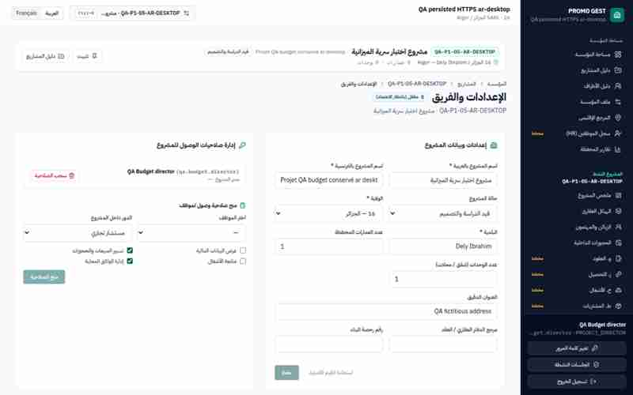
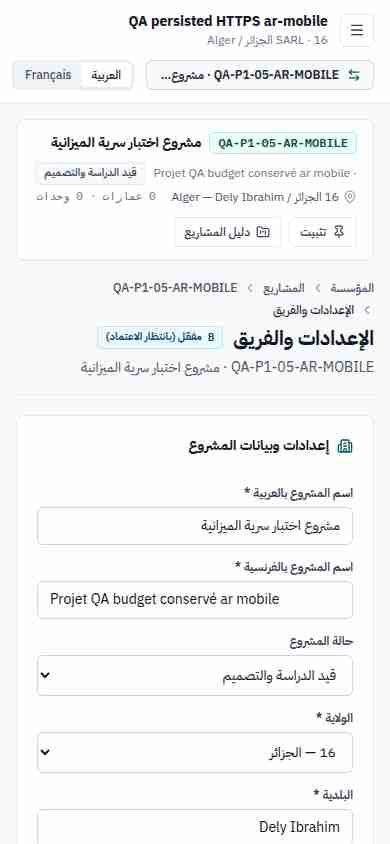
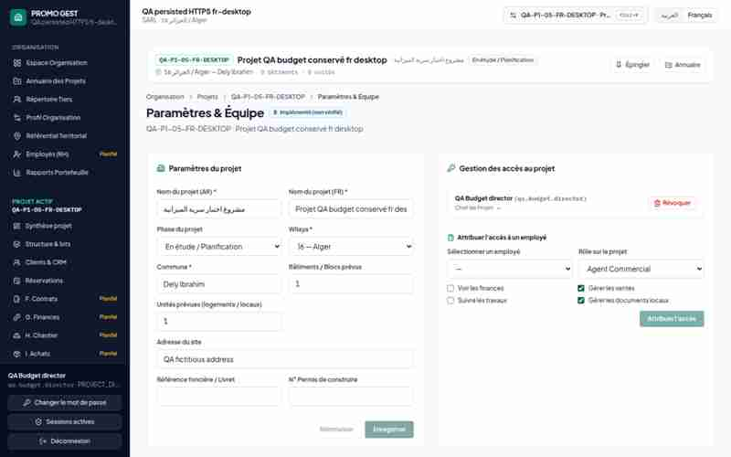
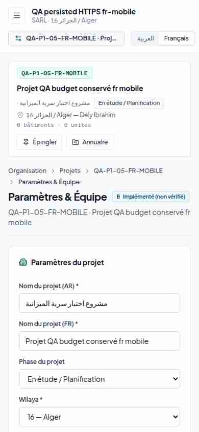

# P1-05 — Project budget browser regression and remaining acceptance

Date: 27 November 2026. Policy: [ADR-0011](ADR/0011-project-estimated-budget-requires-financial-capability.md).

## Accepted closure — 27 November 2026

**Budget P1-05: Done / Verified in live Notion.** All seven technical criteria
below were reconciled after final PR #283 head `2a58c5c17feb03d947f85154cf6d9329d26adf50`
CI [46063031424](https://github.com/younestech31/PROMO-GEST/actions/runs/46063031424)
PASS5/5 and CodeQL [46063031421](https://github.com/younestech31/PROMO-GEST/actions/runs/46063031421)
PASS2/2; all eight listed checks SUCCESS. PR #283 squash-merged at20:44:50Z as
`1e636e0d0a045b5af2da570fea82ceb6628b5dd6`. Independent exact-main
CI [46065714805](https://github.com/younestech31/PROMO-GEST/actions/runs/46065714805)
PASS5/5 and CodeQL [46065714950](https://github.com/younestech31/PROMO-GEST/actions/runs/46065714950)
PASS2/2, including full unfiltered PG18, Development browser, Production HTTPS
restart, restore and dedicated export. [Machine-readable identities](evidence/p1-05-export-2026-11-27/closure-checks.json).

The four screenshots retain **sourceb86760f / testedd22d20 / run46061768797**:
not final-head/main recaptures, concurrency proof or full-page mobile views. The
criterion6 distinction between generic simultaneous project edits with persisted
zero and separate nonzero/null authorization assertions remains unchanged.
Technical acceptance is delegated to the agent; no invented separate-device or
institutional-signature requirement. Distinct phase-closure P1-05 remains
Blocked / Not Started; Phase1 IN_PROGRESS and Phases2–5 gated. Institutional,
legal, accounting, municipality and release approvals stay independent.
Historical pending statements below describe their recorded checkpoints and are
superseded only by this evidence-based closure.

## Scope

`tests/browser/project_budget.py`, called by `phase0.py`, exercises the shipped React SPA
against the actual ASP.NET Core API and fresh PostgreSQL 18 databases. The existing CI
runner executes Arabic RTL / French LTR at 1440×900 and 390×844. This is not the Vite
in-memory preview, a mock, or manual operator acceptance.

The Development fixture permits only its exact loopback CI target and
`p0_<language>_<device>` disposable database; the separate Production HTTPS fixture
is explicitly allowlisted below. Users are created with seeded roles through the API; mandatory password
rotation is completed before browser login. No SQL role/permission changes, schema
changes, migration additions or operational database access are introduced. The Development fixture
API process alone uses a bounded login/password-rotation limiter of 30 requests/minute
because the expanded multi-user suite exceeds ten requests from the same loopback IP.
The shipped default remains ten; no operational security configuration is changed.

## Regression matrix

| Actor / state | API assertions | Browser assertions |
|---|---|---|
| SYSTEM_ADMIN, no project membership | Nonzero creation denied; detail/list/paged directory return null; numeric update denied | Directory dash, overview redaction notice, no budget input |
| PROJECT_DIRECTOR + financial ProjectManager membership | Nonzero creation succeeds with explicit creator membership; decimal update persists | Exact localized directory amount; editable budget; save and reload retain decimal value |
| Same ProjectManager after financial flag removal | All read shapes redact; null update preserves amount; zero and nonzero tampering denied | Directory dash, overview notice, hidden budget input; non-financial name edit saves and survives reload |
| FINANCE_OFFICER, no project membership | Detail denied; list and paged directory exclude project | No UI acceptance claim for non-member deep links in this slice |
| FINANCE_OFFICER + financial FinanceController membership | Amount visible; update denied; independent read confirms all prior denied writes/null update preserved amount | Exact localized amount; general fields disabled; no budget input or save control |
| Audit | Financial-read and access-denial events identify the expected actors and project | Existing audit rendering acceptance is outside this slice |

The administrator's member-assignment responses are also checked for budget redaction.
The test checks authorization immediately with the existing sessions after capability
changes; it does not rely on logging in again to enforce resource scope.

## Mobile correction found during browser execution

The first runs passed the Arabic desktop slice but stopped on Arabic mobile: the
responsive directory uses cards, not table rows. Those cards also omitted the budget
entirely. The fix adds a labeled budget definition to each accessible project article,
using the same `ProjectBudgetValue` component as the desktop table. Authorized amounts
are localized with two decimals; server-redacted null stays a dash, distinct from zero.
Four rendering tests cover null, zero, decimals and LTR isolation in both languages.
Browser assertions target the visible card on mobile and the visible row on desktop;
they must never score a hidden desktop table as mobile evidence.

## Evidence and verification boundary

- Local: `npm ci --no-audit --no-fund`, `npm run lint`, `npm test` (117/117),
  `npm run build`, Python compilation, and `python3 tests/browser/test_project_budget.py`
  (5/5) passed on 27 November 2026. The helper tests check null/zero/decimal payloads,
  fresh CSRF retrieval, missing-token refusal and non-CI/non-disposable target rejection.
- Real ASP.NET Core/PostgreSQL/browser execution is delegated to the PR CI runner;
  no local real-database or browser execution is claimed. This sandbox has no .NET SDK,
  PostgreSQL or Chrome installed. Record the exact-head CI outcome before approval.
- Successful browser runs write `P1_05` into each profile's `result.json` and five
  `p1-05-*.png` screenshots to the existing `phase0-browser-evidence` artifact.
  Artifacts contain synthetic users/projects only; no passwords, cookies, session tokens
  or complete HTTP request/response dumps are written by this scenario.
- Existing-main verification at branch base `562d6340fd10a55d4124d287e082a91709222bf5`:
  [CI 45860100938](https://github.com/younestech31/PROMO-GEST/actions/runs/45860100938)
  (4/4) and [CodeQL 45860100847](https://github.com/younestech31/PROMO-GEST/actions/runs/45860100847)
  (2/2). Those runs predate this new P1-05 scenario and are not evidence for it.

## Observed four-profile CI result and staging follow-up

Final implementation head `d7574d1f7d4a3a7b5f9447ff037933efe78b9e38` passed
[CI 45983974950](https://github.com/younestech31/PROMO-GEST/actions/runs/45983974950)
(4/4) and [CodeQL 45983974923](https://github.com/younestech31/PROMO-GEST/actions/runs/45983974923)
(2/2), including all four P1-05 browser profiles, PostgreSQL integration and the full restore drill.
The earlier wording about execution being delegated to CI is a local-environment boundary,
not an outstanding result for that head.

The helper now also accepts a second **explicit** disposable fixture: the exact HTTPS
staging host, `stg_<language>_<device>` database, and a successful encrypted-key-ring preflight.
Arbitrary staging URLs remain forbidden. Its seven offline helper/safety tests pass locally.
The same budget matrix is called after the Production API restart; this is additional
technical staging evidence, not a human operator signature. This additional matrix passed
all four Production HTTPS profiles in [CI 45988658013](https://github.com/younestech31/PROMO-GEST/actions/runs/45988658013)
on source head `d7768c42ab8c837a9cc5b9abcec6e4f4fd718b1f`; full matrix screenshots
are in `staging-https-evidence`, alongside the permanent compact review images. See
[the Production HTTPS rehearsal record](STAGING-ACCEPTANCE-2026-11-27.ar.md).

## Historical operational-gate wording

At the original checkpoint, P1-05 stayed **In Review / Pending** and **IMPLEMENTED_NOT_VERIFIED** until the authorized
operator performs and signs off the Arabic/French Staging acceptance. Automated CI
must pass first; its screenshots are supporting evidence, not an operator signature.
No Phase 0 closure, Phase 1 closure, Phase 2–5 start, deployment, existing-database
migration, or municipality approval/import is implied.

## Current acceptance reconciliation — 27 November, budget task only

Live Notion task `41a13e9e-d368-812d-bddf-df171088475f` criteria, dependencies,
risk and status re-read before this slice. Owner policy is already decided and
runtime implemented in PR #80; do not implement it again. The user delegated
technical acceptance to the agent; an additional institution-local signature is
not invented as a technical criterion. Installation/legal/accounting acceptance
remains independent. The distinct phase-closure P1-05 record is not this task.

| # | Actual criterion | Current support / remaining work |
|---|---|---|
| 1 | Nullable budget/redaction for list/detail/create/update/member responses | ProjectDto and ProjectService actor-aware mapping; Application ProjectBudget_RequiresExplicitFinancialCapability_ForReadAndWrite and PG18 API/browser assertions. |
| 2 | No SYSTEM_ADMIN or manager bypass | Explicit membership+CanViewFinancials policy; admin and revoked-manager read/write denial tests. |
| 3 | Write requires projects.manage, ProjectManager and financial flag; null preserves amount, numeric denial audited | Service gate, Application/PG18 tests and real SPA general-edit/null/zero/nonzero matrix. |
| 4 | Admin cannot create nonzero budget; explicitly financial creator can | Real API matrix verifies 403/admin and 201/director with explicit financial manager membership. |
| 5 | UI hides editor, sends null, summary dash | Existing four-profile real Production and Development assertions; new bounded export selects actual non-financial manager settings after general save/reload. Images still pending new CI/import/visual review. |
| 6 | Application and PG18 authorized/revoked/read-only/admin/nonmember/concurrency/null paths | Existing suites and browser matrix; recheck exact test identities and concurrency scope before final acceptance. Images cannot prove authorization, storage or races. |
| 7 | Security/navigation/baseline/traceability and G1/G3/G5/G6/G7/G8/G9, full CI | Prior merged results exist; this new tooling/docs head requires its own complete CI and seven-criterion final decision. |

**Status remains In Review / Pending at this checkpoint.** Additive export/import
budget mode reuses the unchanged Production matrix and exact boolean checks;
no matrix assertion is removed, no browser scenario is skipped, no service/security
behavior changes. Bounded notices use the existing five export steps instead of
adding image notices that could exhaust GitHub's job annotation budget. Full PNGs
for authorized manager, redacted admin/manager and read-only finance remain in the
normal artifact; the compact selected image is not mislabeled as all those states.
Original permanent staging images show organization, not budget, and are not reused
as budget visual evidence. No screenshot generation/editing tool is used.

Local tooling: exporter **22/22**, importer **15/15**, budget helper **7/7 PASS**.
Synthetic encoder fixtures are only offline tests, never acceptance screenshots.
Actual new Production browser images/results remain **PENDING CI**, not inherited
from older runs. No local .NET, PG18 or real-browser pass claimed.

### First export execution and bounded follow-up

Source `75fab3f` CI [46059558115](https://github.com/younestech31/PROMO-GEST/actions/runs/46059558115)
**FAIL 3/4**: first Arabic desktop budget-image export failed. Domain/Application,
full unfiltered PG18 integration, four-profile Development browser and four-profile
Production HTTPS/restart matrix all passed before this step. This failed run is
**not** successful acceptance or imported image evidence. CodeQL46059558101 PASS2/2.
Check annotations exposed only exit1; log retrieval redirected to an inaccessible
host (EOF). No size/path/data cause is asserted proven. Follow-up adds static
source-location/exception-type diagnostics, and a tested budget-only dimension
fallback 960×844 → 800×740 → 720×660, quality65/50/35/20, retaining the strict <20000
byte limit and refusing oversized output. Original PNGs remain unchanged. Historical
suite encoders retain their existing bounds. Controlled encoder tests verify fallback,
original preservation and fail-closed final bound; exporter now **24/24 PASS**.
[Machine-readable observed run/job/critical-step identities](evidence/p1-05-export-2026-11-27/checks.json).

PR282 is merged at `2d5bf6d4684179db6ea8707fcc208cce6797872e`; its independent
exact-main CI46059337780 PASS4/4 and CodeQL46059337794 PASS2/2 are now verified.
This does not score PR283's new export as PASS. New head execution remains pending.

### Export passed, notice transport incomplete — dedicated job repair

Source `109abdc59678733d5431176ebb2d9f7cca6026a7` CI46060648111 **PASS4/4**,
CodeQL46060648095 **PASS2/2**. Full integration, Development/Production matrices,
all image/manifest export steps and restore passed. This demonstrates the bounded
encoder succeeds, not the cause of the first run's failure. Strict import then
**correctly rejected** incomplete staging notices and wrote no evidence directory.
GitHub returned exactly50 annotations for job140714017536:10 build warnings,
38 P1-10 chunks, and only2 of7 first-budget-image chunks. This proves a transport
budget loss, not a missing real-browser run or permission failure.

The unchanged five Production export steps now run in a dedicated job, consuming
only the same run's sanitized artifact after backend success. No network target,
service role or screenshot assertion changes. Import requires successful overall
run/backend/export job and exact source/run/tested identities; historical job
selection is supported, but failed new-job fallback is forbidden. Unit tests cover
legacy/dedicated selection, failure/skipped/ambiguous rejection. Importer16/16 and
exporter24/24 PASS. CI now has **five jobs**. New complete image transport, visual
review and final acceptance remain PENDING; a previous successful run is not a
successful import. Original PNGs/previous archives are never overwritten in Git.

## Verified Production evidence follow-up — independent export succeeded

Source `b86760fbb82c71d8f5c2dbc52b24da98acfd10f9` / tested merge
`d22d20b9b5b458f7991135b40b353025a3ac50f7`:
[CI46061768797](https://github.com/younestech31/PROMO-GEST/actions/runs/46061768797)
**PASS5/5**, [CodeQL46061768800](https://github.com/younestech31/PROMO-GEST/actions/runs/46061768800)
**PASS2/2**. Full Domain/Application/unfiltered PG18, Development browser,
Production HTTPS/restart, dedicated image export and restore passed. Strict import
now succeeded: four images/profiles, exact source/run/tested identity and hashes;
all four visually opened and independently rehashed. [Permanent evidence/provenance](evidence/p1-05-production-2026-11-27/README.md).

### Seven-criterion technical assessment (final/main verified above)

Criteria1–5 are supported by ProjectDto/ProjectService and existing Application,
PG18 and four-profile Production budget matrix. Revoked manager null-update
preservation and non-manager financial read-only cases missing from the26Nov
manual report are explicitly exercised by `tests/browser/project_budget.py`.
That older scoped report is not overwritten or silently expanded.

Criterion6: Application tests
`ProjectBudget_RequiresExplicitFinancialCapability_ForReadAndWrite` cover positive,
restricted manager, financial reader, admin/nonmember and denial audits;
`ProjectUpdates_RequireManagementPermission_PreserveCode_AndWriteAudit` covers
stale project edits. `PostgresEndToEndTests.cs` covers financial grants/redaction/
updates, stale `PROJECT_CONCURRENCY_CONFLICT`, two same-version project edits
(one200/one409) and persisted zero budget unchanged; Production matrix additionally
covers preserved **nonzero** budget under null updates and denied writes. These
are distinct checks, not a claim that screenshots demonstrate a simultaneous
nonzero-budget race. Shared root CAS/member race tests remain separate evidence.

Criterion7: security policy unchanged; navigation wording corrected below; baseline
and traceability link this exact evidence. G1 Domain, G3 authorization/scope,
G5 stale/race, G6 audit, G7 realPG18, G8 frontend/realbrowser and G9 full regression
passed in the exact-source CI. Machine-readable check identities include all5jobs.
The final documentation head and exact merged main were independently verified
as recorded at the top; **Notion budget is Done / Verified**. No invented device
or institution-local signature gate; no Phase1 closure/later-phase unlock.

### Reviewed screenshots — exact source above

Arabic desktop (general settings after financial capability removal):

Arabic mobile (top viewport only; DOM proves editor absence across the page):

French desktop:

French mobile (top viewport only):

