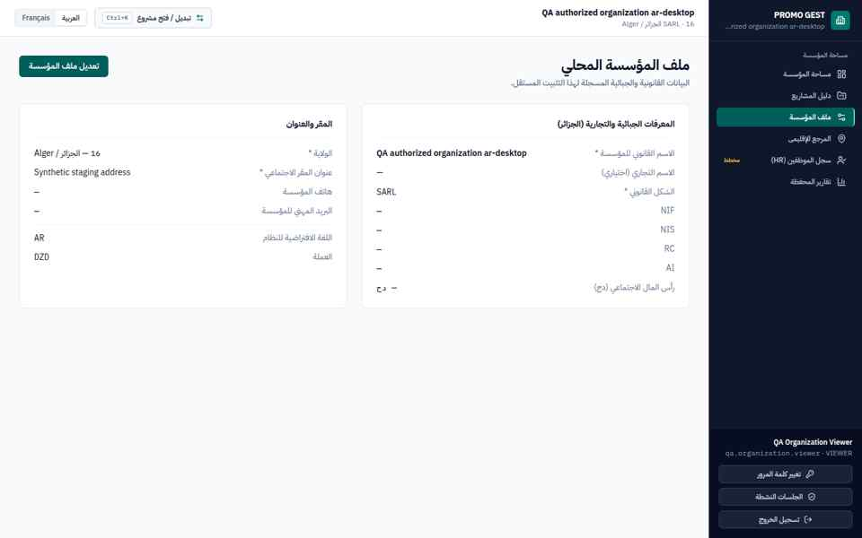
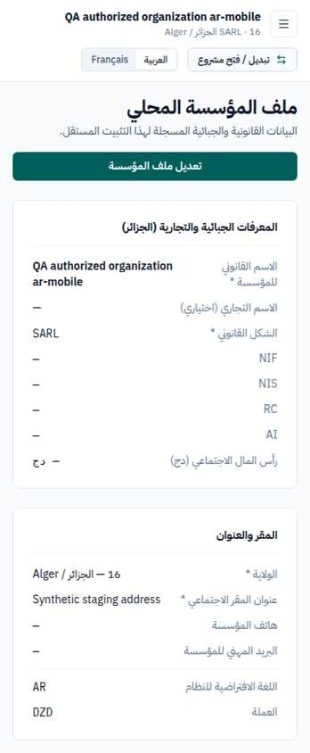
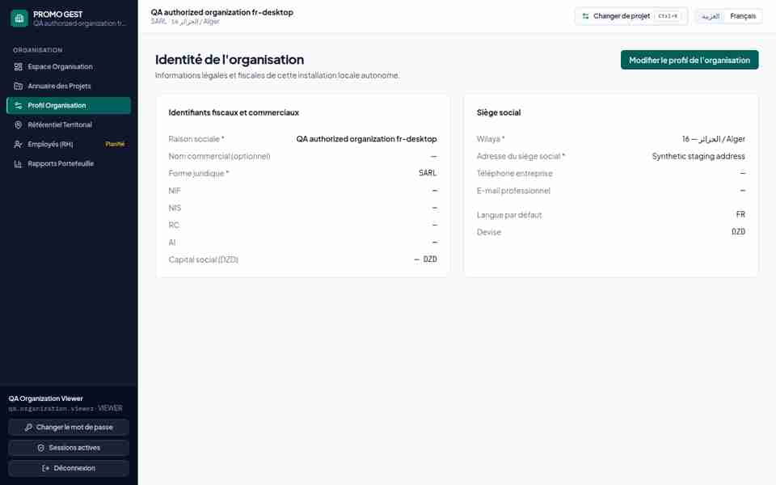
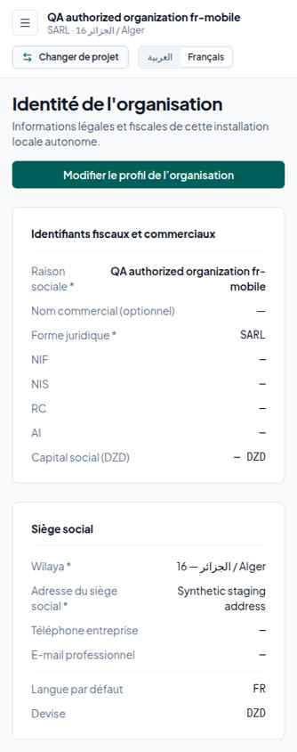

# P1-09 — Production HTTPS organization permission acceptance

Date: 27 November 2026. Status: **isolated Production HTTPS technical acceptance PASS**;
PR #273 remains under review, institution-local/operator acceptance is not asserted.

## Scope and correction

PR #271 is merged as `daefdc107cd3eac0e877c26b984004b1fc55df3b`.
Its Production HTTPS rehearsal covered administrator editing but did not run the
non-administrator P1-09 permission matrix in Production. Development-mode evidence
already exists in `tests/browser/phase0.py`; this slice adds Production coverage.

`canManageOrganizationProfile` previously short-circuited on the administrator flag,
ignoring `isActive` for that one case. It now delegates to `hasPermission`, retaining
the active administrator bypass while denying null/inactive users. This aligns the
button predicate with the existing server authorization; no server policy changes.
The frontend regression explicitly covers inactive administrator and non-admin users,
active administrator, canonical permission, legacy permission denial and anonymous users.

## Real-stack scenario

`tests/browser/organization_permissions.py` runs after the existing budget matrix in
`staging.py`, against the published Production API, Caddy HTTPS and PostgreSQL 18:

1. Create a VIEWER through the real user API; complete mandatory password rotation.
2. Authenticate through the SPA as a non-administrator with no `org.manage`.
3. Verify Arabic RTL / French LTR, read-only profile, absent edit button, direct PUT
   403 `FORBIDDEN_ORGANIZATION_MANAGE`, unchanged profile and `ACCESS_DENIED` audit.
4. Temporarily grant canonical `org.manage` to VIEWER **only in this disposable CI DB**.
   Refuse to overwrite a pre-existing grant. Fresh real SPA login must expose the
   canonical permission (not `organization.manage`) without administrator status.
5. Edit and save through the actual form, reload, independently read persisted name,
   and verify `ORGANIZATION_PROFILE_UPDATED` audit for that actor.
6. Revoke the temporary grant in `finally`. Without logging out the existing session,
   PUT must again return 403 without mutation; SPA reload must hide editing controls.

Runs in all four existing AR/FR desktop/mobile profiles. Each produces two sanitized
screenshots (`org-01-readonly.png`, `org-02-authorized-saved.png`) and
`organization-permissions.json` in `staging-https-evidence`. The existing 15-check
staging manifest and historical screenshots remain unchanged; this additional matrix
is separately reported and must not be inferred from an old manifest's PASS.
The explicit `--suite organization` exporter validates all five new checks per profile,
includes them in `organizationEvidence`, and publishes bounded compact copies of
`org-02-authorized-saved.png`. Default staging exports retain their original meaning.
Full read-only and saved screenshots remain in the artifact; no extra notice steps or
repository-write CI permissions are required.

The guard runs before any I/O: GitHub Actions, loopback PostgreSQL, exact
`stg_<ar|fr>_<desktop|mobile>` DB, fixed local HTTPS origin and encrypted Data Protection
fixture are mandatory. No operational permission catalogue, schema/migration, runtime
security setting, production/Cloud SQL database or deployment is changed. The shipped
Production login limiter remains ten; no limit increase or retry-on-denial is added.
Passwords/sessions and response bodies are never placed in evidence. Exception
reporting names only static source locations and exception classes.

## Verification log

- Local frontend tests: **117/117 PASS**, including the expanded organization predicate test.
- TypeScript check: **PASS** (`npm --prefix apps/local-web run lint`).
- New offline helper tests: **2/2 PASS**, nullable payload/stamp and rejection before SQL/browser/filesystem.
- Python compile: **PASS** for helper and staging runner.
- Production browser matrix: **5/5 named checks in each of four profiles (20 results) PASS**
  in [CI 45994447145](https://github.com/younestech31/PROMO-GEST/actions/runs/45994447145),
  **4/4 jobs PASS**; [CodeQL 45994447199](https://github.com/younestech31/PROMO-GEST/actions/runs/45994447199), **2/2 PASS**.
- Source head `a4b48765a9149b843dd42e40e585968d4ae52893`; tested PR merge
  `433b506db22cb0d0562f7a009c2b792b7d2d027e`. The existing Production baseline also
  passed all 15 named checks per profile (60 results), separately from the new matrix.
- Four compact screenshots imported through the existing verified read-only annotation
  transport, opened visually and SHA-256 rechecked. Permanent [manifest/provenance](evidence/p1-09-production-2026-11-27/README.md);
  eight original organization PNGs and JSON are in [artifact 15195088601](https://github.com/younestech31/PROMO-GEST/actions/runs/45994447145/artifacts/15195088601).
- Exporter validation tests: **10/10 PASS** (including organization completeness/privacy/path checks);
  importer **7/7**, budget helpers **7/7**, baseline **12/12**, hygiene **12/12 PASS**.
  Build, lint ratchet, secret scan and diff checks also pass.
- First implementation run on `f6aad30` was also green: CI 45993498808 **4/4**,
  CodeQL 45993498642 **2/2**. The later run above adds the durable organization-specific export.
- PR #271 exact-main postmerge CodeQL [45992729724](https://github.com/younestech31/PROMO-GEST/actions/runs/45992729724): **SUCCESS 2/2**.
- PR #271 exact-main postmerge CI [45992729728](https://github.com/younestech31/PROMO-GEST/actions/runs/45992729728): **SUCCESS 4/4**.

## Gates

The technical matrix is now executed and its four screenshots reviewed. P1-09's existing
In Review / Pending tracking is retained rather than silently inventing institutional
approval; no Notion status is advanced. This is developer-led isolated Linux technical acceptance,
not an institutional signature, organization workstation setup or Windows service test.
P1-10 retains its acceptance dependency; P1-08 policy is not inferred. P1-01/P1-35
remain Deferred/Pending; P1-02 stays Blocked; Phases 2–5 stay gated.

## Reviewed screenshots — authorized non-admin save and reload

### العربية — سطح المكتب

### العربية — الهاتف

### Français — bureau

### Français — mobile

These images show the authorized state only; 403, audit and existing-session revocation
are proved by executed assertions and the manifest's five-check matrix, not by these
screenshots alone. Full read-only captures remain in the linked original artifact.
