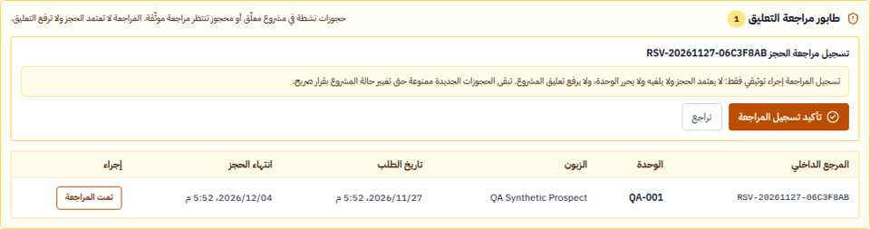
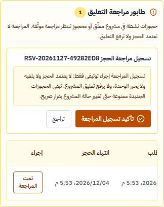
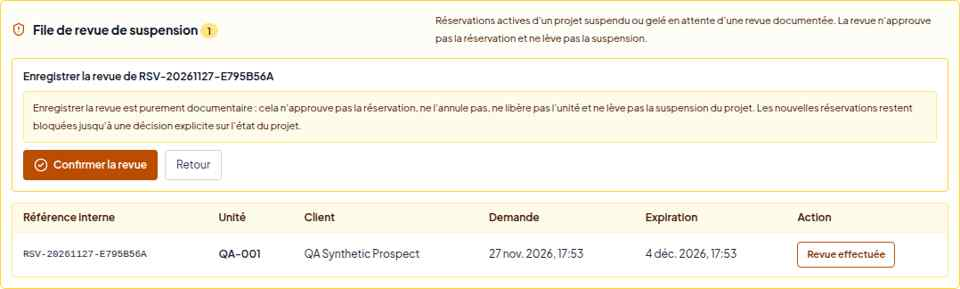
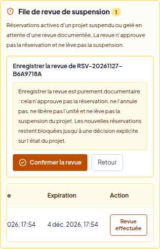

# P1-10 — commercialization and suspension-review acceptance

Date: 27 November 2026. **Task: In Progress / Pending.**
This slice tests existing runtime; it does not implement commercialization again.

## Dependency reconciliation

P1-09 is explicitly **Done / Verified** in Notion after its six criteria were mapped
to implementation and recorded real-stack evidence. See [acceptance decision](P1-09-PRODUCTION-ACCEPTANCE.md).
Its P1-10 acceptance dependency is resolved, not waived. The old “runtime not started”
dependency text was corrected in Notion; prior dated checkpoints remain historical.
ADR-0018 records the approved owner decision of 23 November. Runtime was already
merged in PR #233 (eligibility), #234 (review state), #235 (review API), and #237 (UI).
P1-11 operational acceptance and later-phase/release-scope gates remain separate.

## Actual policy and existing coverage

| Actual `ProjectStatus` | Marketing/new internal hold |
|---|---|
| Planning | Deny |
| UnderConstruction | Deny |
| Commercialization | Allow, subject to normal project/permission/unit/customer checks |
| Delivered | Deny |
| Suspended | Deny; queue active holds for documentary review |
| Undefined/future values | Deny by default; not inferred from a deny-list |

- `ProjectCommercializationPolicyTests.cs`: single allow-list member, all actual
  denied statuses, undefined enum values, transition-only review marker.
- `ProjectSalesReservationEntities.cs`: review request/completion, active hold
  invariants and explicit conflict codes. No implicit cancellation or unit release.
- `PostgresEndToEndTests.cs`: real API/PG18 eligibility, suspension queue,
  review completion, duplicate/stale denial, scope/permissions and audit persistence.
  Other PG18 race tests retain project/unit/hold integrity; sequential browser
  assertions below must not be described as deterministic concurrency testing.
- `reservationReview.test.ts`: queue partition and bilingual non-approval wording.
- `ProjectCustomerStatus.Customer` is CRM only. Internal holds/reviews create no
  contract, receipt, installment, accounting entry or legal/financial approval.
  This test adds none of those operations and does not open Phase 2.

## New four-profile real-browser regression

`tests/browser/commercialization_review.py` is called by `phase0.py` after the
existing budget matrix, using the existing administrator session. It creates only a
synthetic project, building/floor/two units and CRM prospect through real APIs.
No additional account/login, SQL grant, mock or runtime configuration change.
The guard rejects anything except the exact disposable GitHub Actions loopback
`p0_<ar|fr>_<desktop|mobile>` fixture before browser, filesystem or network I/O.
This is a Development-mode published ASP.NET Core SPA/PG18 regression, **not** a
Production HTTPS run or institution-local installation acceptance.

Seven named checks per profile:

1. All four non-commercial actual statuses return 409 `PROJECT_NOT_COMMERCIALIZABLE`
   without changing holds or units.
2. Explicit Commercialization allows a real SPA-created active hold and reserves its unit.
3. Suspension queues that active hold without cancellation, expiry/identity changes or unit release.
4. Stale review stamp returns 409 `CONCURRENCY_CONFLICT`, queue unchanged.
5. Real bilingual SPA review confirmation/completion preserves hold, unit, expiry and
   Suspended project state; queue is empty after reload.
6. Even after review, a new hold on the second available unit is denied without mutation.
7. Exactly one completion audit and a denial audit identify the actor and target.

Screenshots per profile: `p1-10-review-confirmation.png` (actual review-queue section,
confirmation scrolled into viewport) and `p1-10-review-completed.png`, published with sanitized `P1_10` results in
`phase0-browser-evidence`. No credentials, cookies, session state or response dumps
are added to artifacts. Screenshots illustrate UI states, not audit/409/concurrency
proof; those require executed assertions.

## Verification log

- Offline helper tests: **3/3 PASS**, including unsafe-target refusal before I/O and
  field-by-field preservation invariants.
- Python compile: **PASS**, helper and integrated runner.
- Baseline validator tests **12/12 PASS**, hygiene tests **12/12 PASS**;
  nine canonical documents agree on main `484871f99aa62dfb65904ad7ec4100c0a9ac1a29`.
- Local frontend **118/118 PASS**, TypeScript **PASS**.
- First PR #279 run [CI 46043064035](https://github.com/younestech31/PROMO-GEST/actions/runs/46043064035)
  failed in the first AR desktop profile at unit-field selection: an exact wrapping-label
  match did not account for dynamic option text. Corrected to the unique field-caption
  substring; no runtime change. This failed run is **not** acceptance evidence.
  Its CodeQL 46043064081 passed 2/2; other CI jobs passed.
- PR #278 exact-main CI 46042410429 **4/4 PASS**, CodeQL 46042410441 **2/2 PASS**.
- Corrected source `a54e34a6b2bc931be200df5a92ca791f71a18da1`:
  [CI 46043626013](https://github.com/younestech31/PROMO-GEST/actions/runs/46043626013)
  **4/4 PASS**, including all four real-browser profiles. Seven P1-10 checks per profile
  executed successfully (**28/28**); raw PNGs/results in that run's `phase0-browser-evidence`.
  This is executed browser evidence, not a claim of having retrieved/reviewed its screenshots.
- Follow-up source `f6ea6e1`, CI 46043844633: four-profile browser step passed, but
  compact screenshot **export failed**, so the overall run is **FAIL**, not accepted.
  Remote log storage was inaccessible from the restricted workspace; no precise exception
  message is inferred. Added static source-line/class diagnostics. Local encoding of existing
  dense queue screenshots demonstrated that the 20,000-byte budget can be exceeded at
  quality 20; compact transport now has bounded 800/720-pixel fallbacks, and the new
  confirmation PNG captures the actual queue section rather than unrelated full-page chrome.
  Original PNGs are not altered or replaced by the derivative JPEG.
- Exporter tests **6/6 PASS** locally with Pillow, including complete image/manifest plumbing;
  existing staging exporter **19/19**, importer **14/14 PASS**. Dedicated `PG-P1-10-` notices
  and explicit Development mode cannot be mistaken for Production HTTPS evidence.
- Corrected source `99bab26da3dc24d7a18070f40b6b46f0160b8fda`, tested merge
  `04f9224bfc54babeef7c5199a81ae49d5844af2c`:
  [CI 46044806419](https://github.com/younestech31/PROMO-GEST/actions/runs/46044806419)
  **SUCCESS 4/4**, [CodeQL 46044806446](https://github.com/younestech31/PROMO-GEST/actions/runs/46044806446)
  **SUCCESS 2/2**. Four-profile new browser checks **28/28 PASS**; compact export passed.
  Existing Production HTTPS regression and PG18 integration/restore checks also passed
  in that run, but are not mislabeled as new Production P1-10 browser coverage.
- Four actual queue-confirmation JPEGs retrieved through bounded read-only annotations,
  source/run/tested identity and literal-true checks validated, JPEG bytes/SHA-256
  verified and all four opened visually. [Permanent manifest/provenance/images](evidence/p1-10-realstack-2026-11-27/README.md).
  Eight original P1-10 PNGs/results in [artifact 15221942165](https://github.com/younestech31/PROMO-GEST/actions/runs/46044806419/artifacts/15221942165).
  These are pre-completion images; completion/denials/audits are executed assertions,
  not claims inferred from the wrong screenshot state.
- This evidence import/documentation follow-up has its own PR-head checks; source/tested
  identities above are retained unchanged rather than relabeled as the documentation head.

P1-10 remains Pending until its evidence has been reconciled against all seven task
criteria. No institutional signature, new policy decision or operational acceptance
is inferred from the delegated development authority.

## Reviewed queue-confirmation screenshots

### العربية — سطح المكتب

### العربية — الهاتف

### Français — bureau

### Français — mobile

Mobile captures show the scrollable table's action side, not every column simultaneously.
The bilingual documentary-only warning and confirm button are visible in all four.
