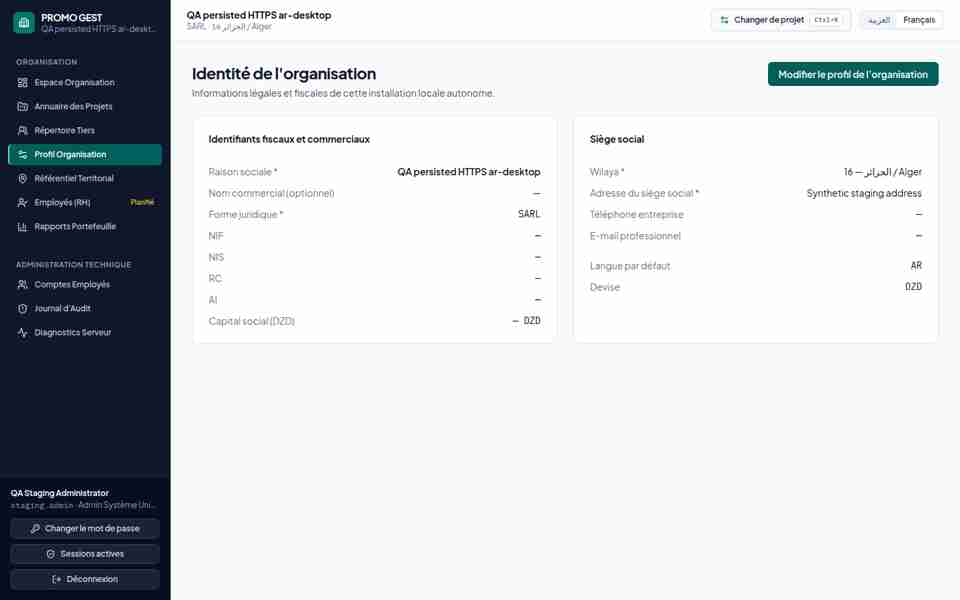
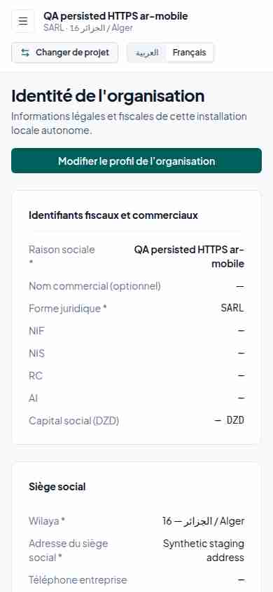
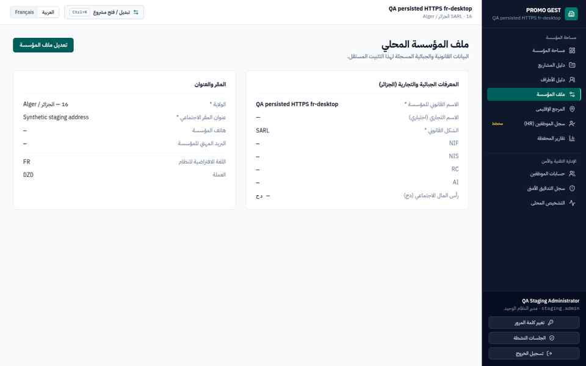
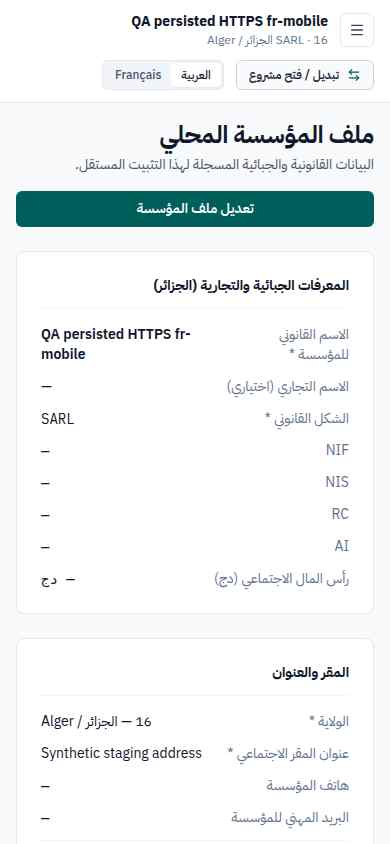

# P1-17 — Production HTTPS language preference acceptance

Date: 27 November 2026. Status: **isolated Production HTTPS technical acceptance PASS**.

نجحت 32 نتيجة تحقق لتفضيل لغة المستخدم بالعربية والفرنسية على الهاتف وسطح
المكتب، بما فيها الاستعادة بعد إعادة الدخول وإعادة تشغيل الخادم، وفشل الاتصال
وتعارض التحديثات، دون تغيير اللغة الافتراضية للمؤسسة. اللقطات أدناه فعلية ومراجَعة.

## Scope

The own-language preference API and SPA persistence wiring are already shipped.
`tests/browser/phase0.py` covers the Development-mode employee scenario. This slice
adds a focused Production HTTPS/restart matrix for the existing administrator's own
preference. No runtime application, API policy, database schema/migration, seeded
permission, session lifetime or deployment configuration changes.

PR #274 was squash-merged as `df350efbd6993a25e87fbc6b67c904ec5be5a347` after final
PR-head CI 46000918302 passed 4/4 and CodeQL 46000918344 passed 2/2. Its P1-19
technical results/screenshots retain their original source/tested-checkout provenance.

## New matrix and boundaries

`tests/browser/language_preferences.py` runs on all four existing isolated Production
HTTPS profiles. It validates the exact disposable CI target and encrypted-key proof
before browser/API/filesystem/SQL I/O. The guard is shared with the previous helpers;
actual persisted encrypted key files are inspected by the staging runner before preparation.

The helper reuses the existing administrator, so the baseline singleton-user check is
unchanged. One extra fresh login occurs **before API restart**; no new verify-phase
login and no Production login-limit override. Passwords stay in memory. The fresh
cookie jar is mode 0600 under the private temporary fixture directory, removed by
shell cleanup and never uploaded as evidence.

Eight named checks per profile:

1. Actual SPA switch from the profile's original language to the opposite language
   returns 200, persists the own preference and leaves the full organization summary,
   including `Organization.DefaultLanguage`, unchanged.
2. Reload and an independent fresh browser login apply the saved language and RTL/LTR.
3. Direct own-preference PUT without CSRF returns 403 and preserves the saved preference.
4. An explicitly injected browser transport failure (abort only the preference PUT)
   keeps the previous locale/persisted value and displays the localized failure alert.
5. A real API update behind the open tab makes its stale stamp return 409
   `USER_CONCURRENCY_CONFLICT`; the SPA refreshes the authoritative server language
   and shows the localized error, rather than pretending the stale write succeeded.
6. After actual API process restart, the saved preference and organization summary
   are reconstructed using the persisted cookie jar and real SPA.
7. Restore the original language via the actual switcher, reload, and independently
   verify the original administrator session sees that own preference while the
   organization summary/default language remains unchanged.
8. Exactly four successful language changes are recorded for that actor in
   `USER_PREFERRED_LANGUAGE_UPDATED`; rejected/aborted writes add no successful event.

Cross-user preference denial, non-admin handling, invalid-language values and concurrent
races are not newly scored by this administrator-focused slice. Existing Development
browser and API/integration coverage remains separate. No institutional/operator
signature or phase-gate advancement is inferred.

## Screenshot meaning

Each profile produces four original PNGs: fresh login, injected network failure,
stale-concurrency refresh and post-restart preference. The exported compact review image
is the **post-restart, opposite-language** screenshot, before restoring the original:

| Profile name / original language | Screenshot language after persisted switch |
|---|---|
| ar-desktop / ar-mobile | French LTR |
| fr-desktop / fr-mobile | Arabic RTL |

The inverse language is intentional evidence of the saved choice, not a mislabeled
translation screenshot. The original-profile name identifies the fixture, not the final
choice. Profile heading, real organization name and HTML language/direction are checked
before capture. Screenshots do not by themselves prove persistence, API denial or audit;
executed assertions and the manifest provide that evidence.

The explicit `--suite language` exporter validates all eight checks plus the existing
baseline, organization and session matrices, exporting only boolean outcomes and static
scope. It uses the existing bounded read-only annotation transport and SHA-256 import;
previous suite defaults/meanings remain unchanged. Full originals stay in
`staging-https-evidence` for 30 days. No cookie state, password, user/session ID or raw
response is exported by the language result. curl validates the local disposable CA;
Chrome ignores trust for that fixture CA only, not an organization certificate rollout.

## Verification log

- New offline helper **3/3 PASS**: guarded I/O rejection and user-stamp-only payload.
- Exporter **16/16 PASS**: completeness, failed/extra-sensitive fields and symlink denial.
- Importer **7/7 PASS**. Python compilation **PASS**.
- Production matrix: **8/8 named checks per profile, 32 results PASS** in
  [CI 46002815426](https://github.com/younestech31/PROMO-GEST/actions/runs/46002815426), **4/4 jobs PASS**;
  [CodeQL 46002815316](https://github.com/younestech31/PROMO-GEST/actions/runs/46002815316), **2/2 PASS**.
- Source `34304e98219d2d576b7a48e98c594174a7c7c52d`, tested PR merge
  `fb627e22ec0d109e2aae7f9f17e89df9f910a3ee`. The baseline (60 results),
  organization (20) and session (32) matrices also remain green.
- Local frontend **117/117**, existing budget **7/7**, organization **2/2**, session
  **5/5**, baseline **12/12** and hygiene **12/12 PASS**. TypeScript, build, lint
  ratchet, repository hygiene and diff checks pass; secret scan clean.
- Four actual screenshots imported, hashes rechecked and each opened for visual
  review; permanent [manifest/provenance and screenshot guide](evidence/p1-17-production-2026-11-27/README.md).
  Sixteen original language PNGs and JSON are in [artifact 15198929016](https://github.com/younestech31/PROMO-GEST/actions/runs/46002815426/artifacts/15198929016).
- PR #274 exact-main CI 46002336753: **SUCCESS 4/4**;
  CodeQL 46002336544: **SUCCESS 2/2**.

P1-17 tracking remains In Review / Pending. P1-08 owner policy, P1-10 acceptance
dependency, P1-01/P1-35 deferral, P1-02 block and Phases 2–5 gates remain unchanged.
No Notion status or institutional sign-off is changed.

## Reviewed actual screenshots — opposite saved language after restart

### البداية عربية — سطح المكتب بعد الاستعادة بالفرنسية

### البداية عربية — الهاتف بعد الاستعادة بالفرنسية

### Initialement français — bureau restauré en arabe

### Initialement français — mobile restauré en arabe

These views illustrate the deliberately switched and persisted preference. The original
fixture language is restored afterward through the real SPA and independently read
from the primary session. API denials, failure handling and audit are supported by
the executed checks, not inferred from the images.

## Six-criterion reconciliation and focused coverage — 27 November

Live Notion criteria, dependencies and risk were reread before this slice. The
tracker still says In Review / Pending; the older statement that AR/FR browser
acceptance has never run is superseded by the executed Production matrix above.
No separate institutional device/signature is a technical gate for this preference.

| Criterion | Concrete evidence / current result |
|---|---|
| Authenticated self-service, no unauthorized other-user change | `AuthController.UpdatePreferredLanguage` takes the actor exclusively from claims; request contract contains only language and stamp. New PG18 test `PreferredLanguageEndpoint_BindsActorDespiteInjectedTarget_AndDeniesCrossUserAdministration` injects a foreign user ID, rejects a foreign stamp with409, denies unauthorized `/api/users/{id}` update with403 and checks that a valid self stamp changes only the actor. **New test CI pending**. |
| ar/fr validation, audit, concurrency | Existing Domain validation and PG18 `PreferredLanguageEndpoint_PersistsSelfPreferenceAndProtectsSessionAndOrganizationState` / `PreferredLanguageEndpoint_ConcurrentUpdatesWithSameSessionStamp_CommitOneChangeAndOneAudit`; new Application service validation theory and actor/audit/stale checks **CI pending**. |
| SPA waits for success or clearly reports failed persistence | Existing real Production network-failure/409 matrix and App.tsx error banner. No success inferred from screenshots alone. |
| Reload / fresh login read persisted SessionResponse preference | Existing eight-check Production matrix in each profile, including fresh login and API restart. |
| API/Application/PG18/UI coverage, self/foreign/invalid/network cases | Existing browser/API/PG18 coverage plus new direct Application tests and explicit persisted foreign-user isolation case above. New coverage is not accepted before actual CI. |
| Organization.DefaultLanguage unchanged | Existing Production and PG18 assertions plus new service and foreign-user endpoint assertions. |

The self-service JSON contract has **no target user**: an injected JSON field is
ignored and never authorizes a foreign update; the separate administrative endpoint
rejects this unprivileged actor with403 `FORBIDDEN_USER_MANAGEMENT`. Do not claim
the self endpoint returns403 merely because an unknown `userId` was supplied.
The new PG18 scenario creates two synthetic unprivileged employees in its own
disposable database; it changes no shipped grants or account policy.

Local frontend118/118, TypeScript, language helper3/3 and baseline12/12 PASS.
No local .NET/PG18 runtime exists. **New C# tests remain NOT RUN locally / CI
pending**, and P1-17 stays In Review / Pending. Existing screenshots retain their
34304e9/testedfb627e2/run46002815426 identity and were not recaptured or relabeled.
