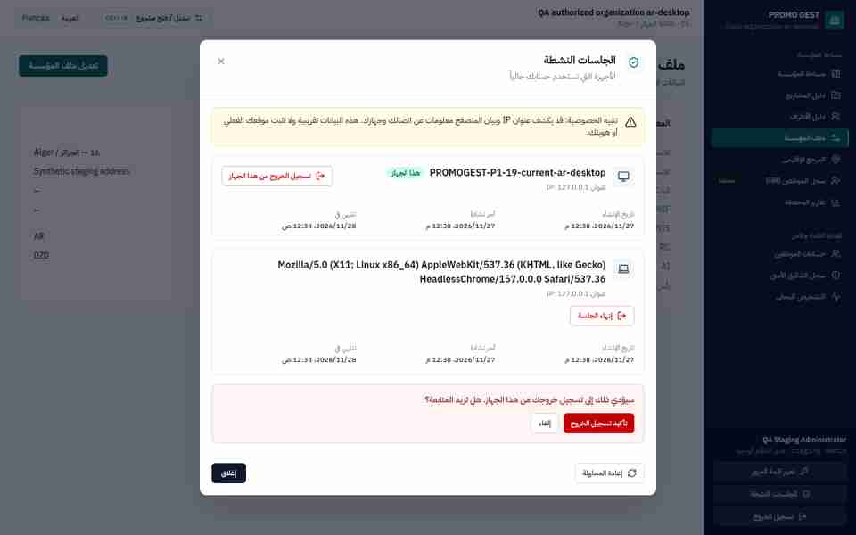
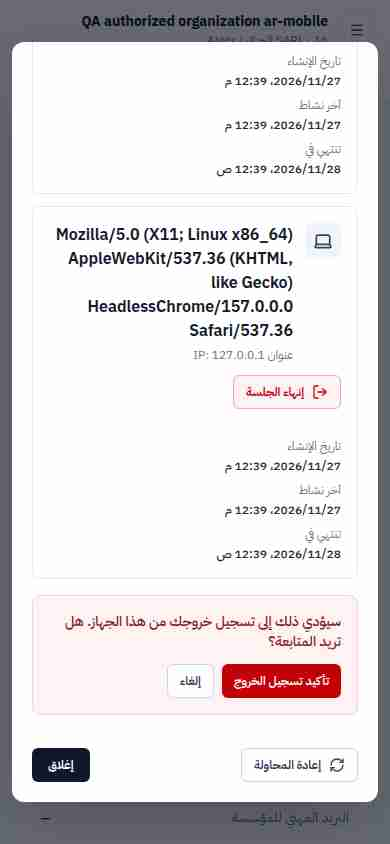
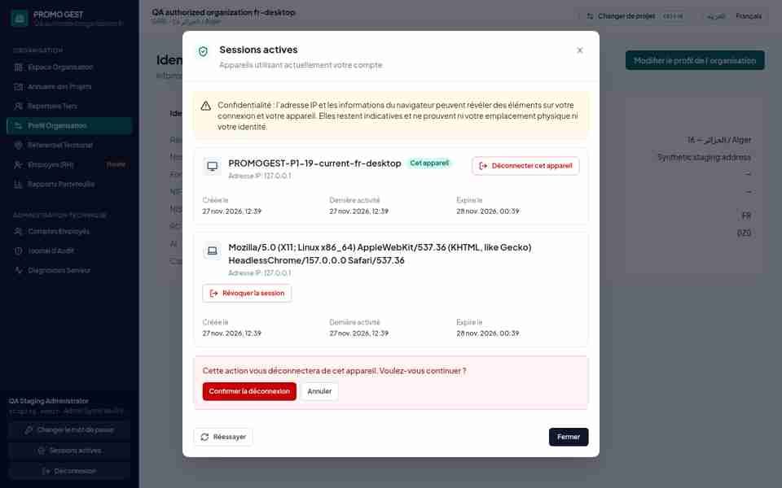
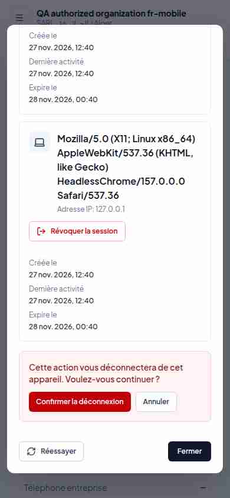

# P1-19 — Production HTTPS active-session technical acceptance

Date: 27 November 2026. Status: **isolated Production HTTPS technical acceptance PASS**.

تم التحقق فعليًا من الجلسات بالعربية والفرنسية على الهاتف وسطح المكتب: نجحت
32 نتيجة تحقق، بما فيها الإبطال الانتقائي ورفض إعادة استخدام الجلسة الملغاة
والتأكيد الصريح قبل تسجيل الخروج. اللقطات أدناه فعلية، وليست صورًا مولّدة.

## Final six-criterion closure — 27 November 2026

**Accepted technically; live Notion Done / Verified at21:40Z.** PR #285 merged at
21:30:45Z as `42f8831fa33e28dde9031eef14b6c1a0efe8b6c1`. Final head `1b1af8cae05ec5f904023543d832c9c1b56c7cda`
independently passed CI46069417557 **5/5** and CodeQL46069417572 **2/2**;
exact merged main passed CI46070780952 **5/5** and CodeQL46070780950 **2/2**.
[All job/step identities and outcomes](evidence/p1-19-production-2026-11-27/closure-checks.json).
Unfiltered PG18 integration (including source0fd301a ownership/preservation cases),
Development browser, Production HTTPS/restart, restore drill and export passed.

The six-criterion mapping below is accepted together with these executed results.
Earlier Pending statements describe the historical checkpoint before final/main
verification and are superseded by this closure, not silently edited into past runs.
The four original screenshots remain source2433962/tested4fa168d/run45999710383;
there is no new-source recapture or local .NET/PostgreSQL execution claim. No
institution-specific signature/device gate is invented. Institution, deployment,
legal/accounting/municipality/release approvals and phase closure remain separate.
P1-06's new failed-save regression is a separate pending navigation slice, not a
condition retroactively added to P1-19 acceptance.

## Scope

P1-19's session list/selective revocation API and bilingual modal are already shipped.
Development-mode real-browser coverage exists in `tests/browser/phase0.py`. This slice
adds isolated Production HTTPS acceptance, including session continuity across API
restart. It changes no runtime application, session lifetime, authentication, schema,
permissions or deployment configuration.

PR #273 was squash-merged as `49add144088a418422da72e9728d7157102fd46a` after
final-head CI 45995665394 passed 4/4 and CodeQL 45995665588 passed 2/2. Its P1-09
technical matrix and permanent screenshots remain valid with their original provenance.

## Scenario

`tests/browser/session_security.py` runs in the four existing AR/FR desktop/mobile
Production fixtures (published API, PostgreSQL 18, Caddy HTTPS, encrypted persisted
Data Protection keys). It first validates the same exact disposable-target guard as
the budget/organization fixtures, before API/browser/filesystem/SQL access.

Two extra administrator sessions are established **before the API restart**, with
synthetic distinct User-Agents. Their cookie state is mode 0600 under the private
temporary directory, never the evidence directory; shell cleanup removes it. No
password is written to a file. After restart, no new login is needed for this slice,
so the shipped Production rate limit remains unchanged.

Eight named checks per profile:

1. Pre-restart sessions remain valid; inventory uses an exact public schema with no
   tokens, token hashes, opaque tokens, SecurityStamp or unexpected fields.
2. Selective revocation without CSRF returns 403 and leaves the target alive.
3. API current-session revocation without confirmation returns 409
   `CURRENT_SESSION_CONFIRMATION_REQUIRED` and preserves the session.
4. Actual SPA inventory is Arabic RTL / French LTR and displays the privacy warning:
   IP/browser information is indicative, not proof of physical location or identity.
5. UI revocation of the chosen other session returns 204, removes it from inventory
   and makes cookie replay return 401 while the current session stays valid.
6. Opening then cancelling current-device sign-out sends no revocation request and
   preserves the current session.
7. Explicit current-device confirmation returns 204, returns the SPA to login and
   makes current/other cookie replay return 401.
8. Both revocations have exactly one audit record each; the independent primary
   administrator session remains valid for the existing staging logout test.

This focused matrix does not claim new expired-session, cross-account IDOR,
concurrent-revocation or reset/deactivation browser coverage; existing PostgreSQL
integration coverage remains separate. No institution/operator signature is inferred.

## Evidence handling

Each profile writes `session-security.json`, `sessions-01-inventory.png` and
`sessions-02-confirmation.png`. Only boolean results, static scope and profile names
are exported in JSON: no session IDs, cookie state or response dumps. The screenshots
contain only synthetic users and loopback/fixture device metadata.

The explicit exporter `--suite sessions` requires all eight checks, plus the existing
organization matrix and baseline staging checks, and publishes compact copies of the
confirmation screenshot using the existing SHA-256-verified read-only annotation
transport. Default staging and organization suite exports retain their meanings.
Full originals remain in `staging-https-evidence` (30 days). curl validates the local
disposable CA; Chrome ignores trust for that fixture CA only, not a workstation
certificate-distribution test. No CI repository-write
permission, additional secret or external database is introduced.

## Verification log

- Offline session helper: **5/5 PASS**, including rejection before I/O, strict public
  inventory schema, secret-field denial, unique current session and UUID validation.
- Exporter: **13/13 PASS**, including session completeness/privacy/path checks.
- Importer: **7/7 PASS**. Python compilation: **PASS**.
- Production matrix on source `ef84570`: CI 45998460931 **SUCCESS 4/4**,
  CodeQL 45998460932 **SUCCESS 2/2**, all eight checks per profile **32/32 PASS**.
  Independent pre-revocation cookie jar returned 200 before and 401 after current
  revocation, proving server-side replay denial rather than only browser cookie removal.
- Visual review of that first export found the mobile confirmation below the
  screenshot viewport despite CSS visibility. It is not accepted as confirmation
  screenshot evidence. The runner now scrolls the actual prompt into the modal
  viewport and asserts it is in view before capture. Corrected capture run 45999710383 passed; all four corrected images were opened
  and reviewed, with the confirmation visible on both mobile profiles.
- First CI 45997518847 stopped at the fail-closed encryption guard before session
  preparation: its proof flag was previously set only after restart. The staging
  exercise now checks the actual private persisted XML key files for encryptedSecret
  before enabling the preparer. No guard is bypassed or weakened; no failed run is
  counted as acceptance. CodeQL 45997518850 passed 2/2 for that source.
- PR #273 exact-main postmerge CI 45997088221: **SUCCESS 4/4**;
  CodeQL 45997088222: **SUCCESS 2/2**.

P1-19 remains In Review / Pending in the task register. P1-08 owner-policy gate,
P1-10 acceptance dependency, P1-01/P1-35 deferral, P1-02 block and Phase 2–5 gates
are not changed by this technical slice. No Notion status is advanced.

## Accepted execution and permanent screenshots

- Source head `2433962fb5f06875b32d118353786ff688ffd895`; tested PR merge
  `4fa168d562393e9171f95f3b6ccc07688c7388f4`.
- [CI 45999710383](https://github.com/younestech31/PROMO-GEST/actions/runs/45999710383): **4/4 PASS**;
  [CodeQL 45999710123](https://github.com/younestech31/PROMO-GEST/actions/runs/45999710123): **2/2 PASS**.
- P1-19 **8/8 named checks per profile, 32 results PASS**. Baseline 15/profile
  (60 results) and organization 5/profile (20 results) also remain green.
- Local frontend **117/117**, session helpers **5/5**, exporter **13/13**, importer
  **7/7**, budget helper **7/7**, organization helper **2/2**, baseline **12/12**,
  hygiene **12/12 PASS**; TypeScript (`npm run lint`), build, lint ratchet, Python
  compilation and repository hygiene pass. Secrets/diff checks are clean.
- Four actual corrected JPEGs are permanently stored with their hashes and provenance
  in [the evidence folder](evidence/p1-19-production-2026-11-27/README.md).
  Eight original session PNGs and JSON are in [artifact 15197598552](https://github.com/younestech31/PROMO-GEST/actions/runs/45999710383/artifacts/15197598552).

### العربية — سطح المكتب

### العربية — الهاتف، تأكيد ظاهر داخل النافذة

### Français — bureau

### Français — mobile, confirmation réellement visible

Mobile captures show the scrolled confirmation, not the privacy note above the scroll
position. The original inventory screenshot and browser assertions support privacy
notice verification. No API behavior is inferred from a screenshot alone.

## Six-criterion reconciliation — 27 November

Live Notion criteria/dependencies/risk and the explicit26November remaining
boundary were reread before this slice. No new runtime implementation is needed.
The manual report's omitted IDOR/expired/race/revoke-all cases are **not** silently
added to that historical report or inferred from screenshots.

| Criterion | Evidence and bounded follow-up |
|---|---|
| Own sessions only, public timestamps/IP/User-Agent, no secrets | Existing `SessionManagement_ListOwnActiveSessionsWithoutSecrets_AndRevokeSelectedSession`, owner-bound repository and exact public-schema Production checks. Original inventory/privacy screenshots contain only synthetic metadata. |
| Owner-bound revocation / IDOR denial / audit | Existing `SessionManagement_RejectsForeignExpiredAndAlreadyRevokedSessionIds` returns404 `SESSION_NOT_FOUND` for all three, not403. New assertions verify foreign row remains unrevoked, expired row remains untouched, old revoked row stays revoked, caller still works, and no false success audit. **New assertions source CI PASS**. |
| Selective revoke / current-session choice | Existing PG18 list/selective/current-confirmation tests and eight-check four-profile Production matrix: current session retained, explicit confirmation409, confirm204/logout, cancel sends no request; independent retained-cookie replay401. |
| PG18 foreign / expired / revoked / replay / concurrent revoke | Existing tests above and `SessionManagement_ConcurrentRevocationCommitsOneUpdateAndOneAudit`: same target race one204 + one409 `CONCURRENCY_CONFLICT`, exactly one success audit, target replay401. This is same-account concurrency, not foreign-owner browser acceptance. |
| AR RTL / FR LTR privacy and confirmation | Existing32/32 Production results plus four corrected images below; mobile images show the scrolled confirmation, not the privacy note above it. Inventory screenshot and DOM checks prove the notice separately. |
| Reset/deactivation still revoke all | Existing lifecycle/reset and deactivation integration tests; new two-case `SessionManagement_ResetOrDeactivationRevokesAllEmployeeSessionsWithoutRevokingAdministrator` explicitly logs in twice, snapshots original cookies in memory, resets/deactivates via administrator API, checks both persisted rows revoked/security stamp rotated/exact actor-target audit/unaffected admin, replays original cookies401, and reactivation cannot revive old cookies. **New theory source CI PASS**. |

The new preservation theory uses one isolated disposable PG18 database per case.
Two ordinary employee sessions and an administrator are real API logins; cookies
are kept only in test memory and never logged/uploaded. Synthetic accounts are
prepared directly in that disposable database without shipped-grant changes.
No new session lifetime, idle policy, sliding expiry, runtime change or admin-wide
session inventory is introduced. No local .NET/PostgreSQL runtime exists, so
**new C# cases NOT RUN locally / source CI PASS**. P1-19 stays In Review /
Pending until executed/full/final-main evidence is reconciled. P1-17 merged and independent main checks passed, with live Notion Done / Verified; institutional,
legal/accounting/municipality/release and phase gates remain independent.

### Executed source verification and repeated image review

Exact source `0fd301ab6f0b9b53fc9bd5f075a61d5fe2d8cd57`:
[CI46068409865](https://github.com/younestech31/PROMO-GEST/actions/runs/46068409865)
**PASS5/5**, [CodeQL46068409882](https://github.com/younestech31/PROMO-GEST/actions/runs/46068409882)
**PASS2/2**. Build, unfiltered Domain/Application/PG18, four-profile Development
browser, Production HTTPS/restart, restore drill and dedicated export all PASS.
The two revoke-all Theory cases and strengthened foreign/expired/revoked denial
assertions executed successfully in that full PG18 suite. Existing deterministic
concurrent-revoke (one204/one409/oneaudit) and cookie replay cases also remain green.
[Machine-readable job/critical-step evidence](evidence/p1-19-production-2026-11-27/preservation-checks.json).

All four corrected original JPEG hashes were rechecked against the manifest and
all four images reopened: AR RTL/FR LTR desktop shows privacy/inventory/confirmation;
mobile shows confirmation after scrolling, not the privacy notice above it. These
remain source2433962/tested4fa168d/run45999710383, not new-source captures or proof
of PG18 races/revoke-all. No UI change requires recapture. First below-viewport
mobile captures and original encryption-guard failure remain historical failures,
not accepted evidence.

Local frontend118/118, TypeScript, session-helper5/5 and baseline12/12 PASS;
hygiene/secrets/diff checks clean. No local C# execution claimed. All six technical
criteria now have executed evidence. **P1-19 remains In Review / Pending until
this documentation head and eventual exact merged main are independently checked**.
No invented institution-local device/signature gate and no release approval implied.
