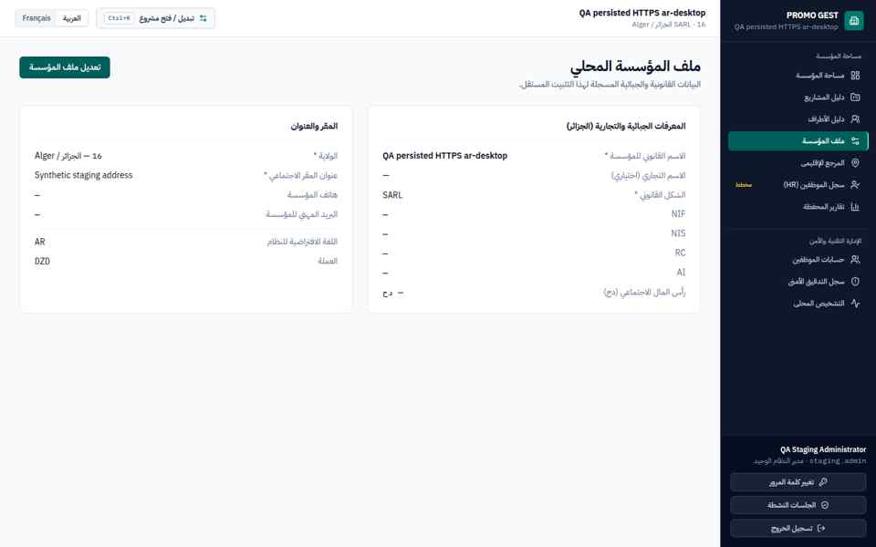
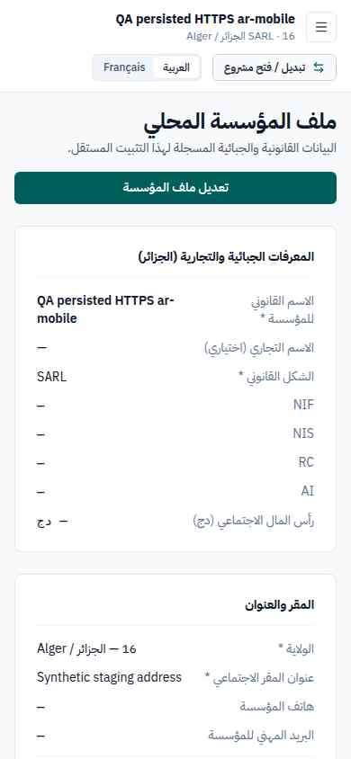
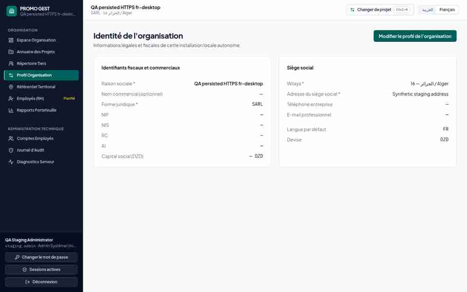
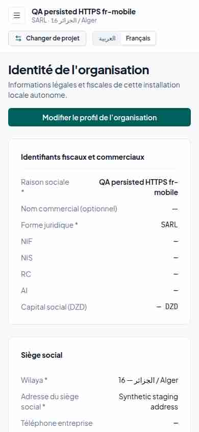

# بروفة قبول تقنية معزولة — 27 نوفمبر 2026

## معنى هذه التجربة

هذه بيئة تجريبية مؤقتة داخل مشغّل Linux في GitHub Actions، وليست بيانات المؤسسة
وليست موقعًا عامًا. تشغّل النسخة المنشورة من ASP.NET Core مع واجهة React المبنية،
بوضع **Production**، خلف **Caddy HTTPS**، وقاعدة **PostgreSQL 18** جديدة لكل ملف اختبار.
هذا يختلف عن اختبار Vite الوهمي، ويختلف أيضًا عن تشغيل الاختبارات السابقة بوضع Development.

**تصنيف القبول:** بروفة تقنية يقودها الوكيل بأدوات آلية. ليست توقيع مشغّل بشري،
ولا تثبت اكتمال تثبيت Windows/Linux داخل المؤسسة أو اعتماد الإجراءات القانونية والمحاسبية.
لا تُحوِّل نجاح السيناريوهات المحددة إلى اعتماد شامل للنظام.

## ما يجري اختباره

أربعة ملفات مستقلة: العربية RTL والفرنسية LTR، كل منهما على الحاسوب 1440×900
والهاتف 390×844. لكل ملف قاعدة جديدة وملفات ومفاتيح خاصة به.

| السيناريو | النتيجة المطلوبة |
|---|---|
| HTTPS خلف Caddy | اتصال HTTPS فعلي، وcurl يتحقق من شهادة الجذر التجريبية |
| ترويسات الأمان | HSTS ليوم واحد، CSP، منع تخمين نوع المحتوى، وعدم تخزين استجابات API مؤقتًا |
| مسار المعاينة الوهمية | غير موجود: 404 |
| التهيئة بلا رمز bootstrap | رفض 403 |
| معالج التهيئة عبر الواجهة | 201، ثم شاشة دخول مجهولة الهوية، ورفض التهيئة المتكررة 409 |
| جلسة Production | كوكي __Host-، Secure وHttpOnly وSameSite=Strict |
| تعديل ملف المؤسسة | حفظ عبر الواجهة وظهور القيمة في API |
| تعديل بلا CSRF | رفض 403 وعدم تطبيقه |
| وثيقة اصطناعية | رفع عبر الواجهة إلى التخزين المحلي |
| إعادة تشغيل عملية API | بقاء المؤسسة والجلسة والوثيقة دون إعادة التهيئة |
| مفاتيح حماية البيانات | استمرار الحلقة المحفوظة مشفرة بشهادة PKCS#12 محلية |
| سلامة الوثيقة بعد إعادة التشغيل | تطابق البايتات وSHA-256 |
| الوصول المجهول للوثائق | رفض العرض والتحميل 401 |
| عدد سجلات التهيئة بعد الإعادة | مؤسسة واحدة، مستخدم واحد، مدير نظام واحد |
| صلاحيات الميزانية P1-05 بوضع Production | إعادة تنفيذ مصفوفة الحجب والكتابة والقراءة وسحب الصلاحية والتدقيق، على الملفات الأربعة |
| الخروج | إبطال الجلسة الحالية وإعادة إرسال جلسة ما قبل إعادة التشغيل |

## الحدود الأمنية والتشغيلية

- المشغّل يرفض التنفيذ خارج GitHub Actions ويرفض إعدادات Cloud SQL وDocker البعيد
  الموروثة. لا يتصل إلا بخدمات المشغّل المحلي وقواعد stg_ar_desktop ونظيراتها الجديدة.
- الترحيل بهوية المالك؛ تشغيل API بهوية التطبيق المقيدة. لا تعديل للصلاحيات المزروعة.
- كلمة مرور الشهادة ورمز التهيئة وكلمات مرور المستخدمين عشوائية ومؤقتة. لا تظهر
  في التقرير أو الصور أو المرفق. حالة المتصفح والكوكيز والسجلات تبقى في مجلد خاص يُحذف.
- لا تغيير لحد تسجيل الدخول الافتراضي في بروفة Production.
- متصفح الاختبار يتجاوز الثقة في سلطة الشهادة التجريبية فقط؛ curl يفحص الشهادة
  باستخدام جذرها. **توزيع ثقة الشهادة على أجهزة المؤسسة ليس مختبرًا هنا.**
- لا تشمل البروفة خدمة systemd/Windows Service، إعادة تشغيل الجهاز أو قاعدة البيانات،
  التشفير الكامل للقرص، استعادة نسخة مؤسسة فعلية، الحمل المتزامن، أو قبول جميع الوحدات.
- لا يُغلق هذا وحده P0-A01/P0-A04 أو P1-05/P1-09/P1-36/P1-38؛ لكل منها نطاق
  ومتطلبات أوسع أو توقيع تشغيلي. يجب فصل نجاح الاختبار التقني عن تلك المتطلبات.

## إعادة التنفيذ والأدلة

تُنفذ خطوة `Rehearse isolated Production HTTPS staging and restart (four profiles)`
بعد بناء النسخة واختبارات المتصفح الأساسية داخل وظيفة .NET/PostgreSQL في CI.
البرامج: `tests/browser/run-staging.sh` و`tests/browser/staging.py`.

- المرفق `staging-https-evidence` يحفظ عشر صور PNG أصلية لكل ملف (خمسة للتشغيل وخمسة للميزانية) ونتيجة JSON.
- `manifest.json` يسجل SHA المصدر، وSHA نسخة الدمج المختبرة في CI، ورقم التشغيل،
  وإصدار المتصفح والوكيل، والفحوص والصور وبصماتها.
- تُنشر أربع صور مراجعة JPEG مصغرة ومحضرها في تنبيهات تحقق مقيدة الحجم. يتيح ذلك
  نقلها عبر api.github.com إلى هذه البيئة المقيدة دون منح CI صلاحية كتابة المستودع.
- الاستيراد يتحقق من نجاح التشغيل، ومصدره، واكتمال الملفات الأربعة، وSHA-256 للصور؛
  يرفض المسارات غير المعروفة أو الأدلة الناقصة، ولا يستبدل مجلد أدلة قائمًا.

```bash
python3 scripts/import-staging-evidence.py --run RUN_ID --out docs/evidence/staging-2026-11-27
```

## سجل التنفيذ

**النتيجة الفعلية: PASS للملفات الأربعة؛ 15 فحصًا مسجّلًا لكل ملف، أي 60 نتيجة ناجحة.**
هذا عدد مفاتيح التحقق المسماة، وليس عدد جميع تأكيدات المتصفح وAPI داخلها.

- نسخة المصدر: `d7768c42ab8c837a9cc5b9abcec6e4f4fd718b1f`.
- نسخة الدمج التي اختبرها Actions: `842cb296e25f1839a47df001ac21345b92593157`.
  تُحفظ النسختان صراحة لتجنب الخلط بين رأس PR ونسخة الدمج الاصطناعية.
- [CI 45988658013](https://github.com/younestech31/PROMO-GEST/actions/runs/45988658013):
  نجاح **4/4** وظائف، بما فيها البروفة، واختبارات PostgreSQL، وتمرين استعادة قاعدة البيانات
  والملفات ومفاتيح Data Protection، ونشر Windows الاختباري.
- [CodeQL 45988658035](https://github.com/younestech31/PROMO-GEST/actions/runs/45988658035):
  نجاح تحليلي C# وJavaScript/TypeScript **2/2** على رأس المصدر نفسه.
- Chrome: `157.0.8103.78`؛ Caddy: `2.10.2`؛ PostgreSQL: 18؛ وضع التطبيق: Production.
- [المرفق الأصلي staging-https-evidence](https://github.com/younestech31/PROMO-GEST/actions/runs/45988658013/artifacts/15192897248)
  يتضمن 40 صورة PNG ونتائج الملفات الأربعة ومحضرها؛ احتفاظه 30 يومًا بحسب إعداد CI.
- حُفظت أربع صور مراجعة JPEG داخل Git مع
  [المحضر](evidence/staging-2026-11-27/manifest.json) و[مصدر الأدلة](evidence/staging-2026-11-27/provenance.json).
  تم الاستيراد والتحقق من البصمات بنجاح، ثم فتح الصور الأربع ومراجعتها بصريًا بواسطة الوكيل.
- محليًا: TypeScript والبناء وlint ratchet ناجحة؛ اختبارات الواجهة **117/117**،
  وحارس/مساعد الميزانية **7/7**، وتصدير الأدلة **7/7**، واستيرادها **7/7**،
  واختبارات اتساق التوثيق **12/12**. لا يُنسب تشغيل Production إلى هذه الحاوية؛ نُفّذ في مشغّل CI.

| الملف | النتائج المسماة | الميزانية بوضع Production | بعد إعادة تشغيل API |
|---|---:|---|---|
| العربية — حاسوب | 15/15 PASS | PASS | المؤسسة والجلسة والوثيقة باقية |
| العربية — هاتف | 15/15 PASS | PASS | المؤسسة والجلسة والوثيقة باقية |
| الفرنسية — حاسوب | 15/15 PASS | PASS | المؤسسة والجلسة والوثيقة باقية |
| الفرنسية — هاتف | 15/15 PASS | PASS | المؤسسة والجلسة والوثيقة باقية |

### ملاحظات الصور والمراجعة البصرية

الصور أدناه لملف المؤسسة **بعد إعادة تشغيل API**، بالقيمة التي حُفظت قبل الإعادة.
تُظهر اتجاه العربية RTL والفرنسية LTR، وتحوّل البطاقات إلى ترتيب عمودي على الهاتف.
الأسماء والعنوان والمعرّفات اصطناعية. هذه مراجعة للمشاهد المعروضة فقط وليست اعتمادًا
بصريًا لكل صفحات البرنامج. صور الحاسوب مصغرة من 1440×900 إلى 960×600؛ النسخ الكاملة
وباقي سيناريوهات الميزانية والوثائق داخل المرفق الأصلي.

#### العربية — الحاسوب



#### العربية — الهاتف



#### الفرنسية — الحاسوب



#### الفرنسية — الهاتف



### ما جرى تصحيحه أثناء تجهيز الأدلة

نجح التشغيل التقني الأول، لكن واجهة تنبيهات GitHub اختصرت الرسائل إلى 4096 حرفًا
ثم حدّت التنبيهات إلى عشرة لكل خطوة. لم تُستورد تلك الصور الناقصة ولم تُعدّل بصماتها
لتبدو صالحة. عُدّل النقل إلى أجزاء لا تتجاوز 3000 حرف مع نشر كل سجل في خطوة مستقلة،
وتحديد صورة المراجعة بأقل من 20 KB، وإضافة اختبارات فقد الأجزاء وترتيبها وسلامتها.
الصور الحالية مستوردة من التشغيل الناجح المذكور أعلاه فقط.

**الخلاصة:** تحقق القبول التقني المعزول للنطاق المذكور، ولم يتم نشر النظام أو تغيير
بيانات المؤسسة أو اعتماد تثبيت موقعي أو إغلاق المراحل الأعلى تلقائيًا. أُزيلت بيئة
التجربة بعد انتهاء الاختبار؛ لا يوجد رابط Staging دائم متروك يعمل.
